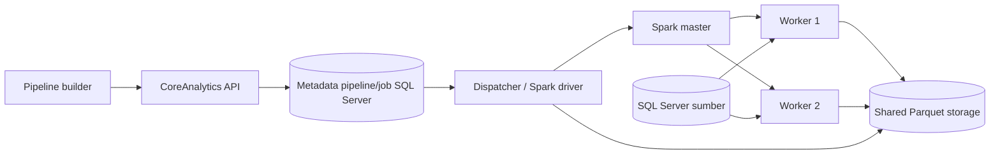

# CoreAnalytics: batch Spark dan cluster terpisah

Keputusan implementasi: seluruh output data menggunakan **Parquet**; metadata pipeline, versi dan job menggunakan **CoreAnalytics SQL Server**. Cluster baru dipisahkan dari layanan voice-auth/dashboard. Konfigurasi dalam repository ini menyiapkan Spark Standalone 3.5.8 dengan 1 master, 2 worker dan 1 gateway.

## Yang sudah diimplementasikan

- `run_batch.py`: private entry point untuk `spark-submit`; credential sumber dikirim lewat stdin, bukan command line atau graph tersimpan.
- `app/batch_graph.py`: DAG Spark DataFrame penuh untuk Text, Dates/Numbers, Utility, Filter, Combine, Aggregate dan Pivot. Tidak melakukan sampling/collect untuk setiap node. Teks dan tipe sumber dipertahankan; hanya operasi Limit/substring yang secara eksplisit diminta pengguna yang membatasi hasil.
- Input dimaterialisasi sekali per run ke snapshot Parquet sementara. Semua cabang/output membaca snapshot yang sama; tidak membaca ulang tabel sumber untuk setiap output. Snapshot dari beberapa sumber bukan transaksi global lintas database.
- `app/batch_storage.py`: semua output ditulis ke staging, dihitung dari artifact yang tersimpan, lalu satu direktori run dipublikasikan melalui rename pada filesystem yang sama. Manifest berisi schema dan jumlah baris. Run ID immutable; versi lama tidak ditimpa. Staging milik run dibersihkan pada kegagalan normal. Dispatcher merekonsiliasi manifest committed setelah crash; run tanpa manifest tidak otomatis diulang.
- `studio_batch_bindings.py`: otorisasi seluruh dataset sebelum membaca credential; resolusi host mengikuti kebijakan SQL Server yang sudah ada dan mengikat JDBC ke IP yang dipin. Browser tidak boleh mengirim JDBC URL, password, source path atau Spark master.
- Image resmi Apache Spark dipin ke digest multi-arsitektur. Master/worker memakai autentikasi bersama dan enkripsi RPC; REST submission dinonaktifkan. Bootstrap membaca secret eksternal dan menjatuhkan UID/GID ke 185 sebelum menjalankan Spark.
- API `/api/studio/pipelines`: simpan/muat versi per pengguna, submit idempotent berdasarkan versi tersimpan, list/detail job, dan pembatalan. Semua endpoint mengikuti session/access Data Studio; mutasi membutuhkan CSRF. Dokumen disimpan tanpa status sementara React/preview.
- `studio_dispatcher.py`: antrean SQL ber-lease 90 detik, heartbeat, revalidasi akses dan sumber, driver terpisah dengan timeout/pembatalan, serta rekonsiliasi manifest. Credential aplikasi tidak diteruskan ke environment driver.
- UI: Simpan versi, Muat pipeline, Jalankan Spark batch, dan Job Monitor dengan jumlah baris serta schema output. Komponen batch yang belum didukung ditolak.
- Migrasi `006` dan `007` serta snippet hook `008` **belum diterapkan ke SQL Server/BEAM**. Tombol batch tidak diaktifkan bila metadata belum terhubung. SQL procedure masih memerlukan uji pada SQL Server target.

Script Python/R, Data Science, Performance dan AI masih memakai adapter preview. Engine batch menolaknya secara eksplisit. Menghapus batas 50 baris dari adapter tersebut akan mengubah semantik/memori/biaya dan bukan implementasi batch yang benar; tahap berikutnya membutuhkan kontrak adapter masing-masing.

## Topologi awal



Driver Python berjalan di gateway dengan `--deploy-mode client`; executor berada pada worker terpisah. Spark Standalone 3.5 tidak mendukung Python deploy-mode `cluster`. Ini tetap eksekusi terdistribusi, bukan local-mode. [Spark submission](https://spark.apache.org/docs/3.5.8/submitting-applications.html).

`docker-compose.spark.yml` memisahkan stack cluster dari Compose aplikasi. File ini menjalankan node cluster sebagai container pada **satu host cluster**. Untuk beberapa VM fisik, pindahkan worker ke host masing-masing, pakai DNS/IP privat yang dapat dirutekan, dan pasang filesystem bersama pada path identik. Konfigurasi awal ini belum HA dan tidak membuat VM/server remote secara otomatis.

## Persiapan dan startup

Siapkan folder data host yang kosong dan dapat ditulis UID/GID 185 (lihat [panduan storage](STORAGE.md)). Path di dalam container tetap `/var/lib/coreanalytics/parquet`. Contoh environment deployment tersedia pada `spark.env.example`.

Buat shared secret di lokasi di luar repository; simpan file dan backup secara terlindungi. Contoh (ganti path sesuai server):

```sh
umask 077
openssl rand -hex 32 > /secure/coreanalytics/spark-auth-secret
export STUDIO_PARQUET_HOST_PATH=/srv/coreanalytics/parquet
export STUDIO_SPARK_SECRET_FILE=/secure/coreanalytics/spark-auth-secret

docker compose -f docker-compose.spark.yml build
docker compose -f docker-compose.spark.yml up -d
```

Jangan menaruh secret dalam `.env` yang dikomit. Bootstrap memakai secret untuk membuat konfigurasi Spark private runtime dan tidak menaruh nilainya dalam argv. Admin yang memiliki akses root/Docker tetap berada dalam trust boundary cluster. [Spark security](https://spark.apache.org/docs/3.5.8/security.html).

Cipher RPC memakai default Spark AES/CTR dengan auth engine versi 2. Pada verifikasi Spark 3.5.8, AES/GCM menyebabkan registrasi worker berhenti; gejala yang sama dilaporkan pada [SPARK-47172](https://issues.apache.org/jira/browse/SPARK-47172). Karena CTR bukan AEAD, konfigurasi ini dibatasi ke jaringan privat tepercaya; pemilihan versi Spark/cipher dan perlindungan jaringan harus ditinjau untuk deployment nyata.

Master RPC hanya tersedia pada network privat stack. UI master dipetakan ke `127.0.0.1:18088` pada host cluster, untuk akses administrator melalui tunnel. Worker/executor perlu konektivitas dua arah ke gateway; port driver 39100 dan block manager driver 39101. Konfigurasi gateway saat ini untuk **satu job aktif** per gateway; dispatcher menjalankan satu job aktif. Jalankan tepat satu instance dispatcher pada tahap ini.

Semua node harus memakai versi Spark/Python yang cocok. Default resource tiap worker: 2 core/2 GiB slot Spark; job menggunakan total 2 core, executor 1 GiB/core dan driver 1 GiB. Sesuaikan melalui `STUDIO_SPARK_WORKER_CORES`, `STUDIO_SPARK_WORKER_MEMORY`, `STUDIO_SPARK_JOB_CORES`, `STUDIO_SPARK_EXECUTOR_MEMORY`, `STUDIO_SPARK_DRIVER_MEMORY`. Resource slot Spark tidak sama dengan limit container/cgroup; kapasitas dan limit deployment perlu ditetapkan pada server nyata.

## Storage Parquet

Tahap ini mendukung filesystem POSIX bersama dan publikasi rename atomik. Compose memakai **bind mount** dari folder host `STUDIO_PARQUET_HOST_PATH` ke `/var/lib/coreanalytics/parquet` pada seluruh node. Folder harus sudah tersedia; `create_host_path: false` mencegah Docker membuat folder kosong secara otomatis karena salah path. Data berada di filesystem host, terpisah dari lifecycle container. Reader memakai folder yang sama dalam mode read-only. Backup folder/disk host tetap diperlukan. Pada multi-VM gunakan shared filesystem seperti NFS dengan path dan UID/GID 185 yang konsisten; jangan memakai direktori lokal yang berbeda pada tiap worker. **S3/HDFS belum menjadi backend publikasi** karena memerlukan mekanisme commit/manifest yang berbeda dari `Path.rename`.

Layout hasil:

```text
<storage-root>/<run-uuid>/manifest.json
<storage-root>/<run-uuid>/output-0/part-*.parquet
<storage-root>/<run-uuid>/output-1/part-*.parquet
```

Catalog/Data Explorer harus membuka versi output berdasarkan metadata yang diotorisasi, bukan menerima path dari browser. Batas baris hanya untuk halaman tampilan; jumlah baris output sebenarnya tercatat di manifest.

## Submit internal

Dispatcher mengambil graph/version yang sudah disimpan, mengotorisasi ulang sumber sebagai pengguna pemilik request, menyelesaikan binding JDBC, lalu mengirim request private:

```sh
docker compose -f docker-compose.spark.yml exec -T spark-gateway \
  python3 /opt/coreanalytics/start_cluster.py submit < private-bound-job.json
```

Request harus satu baris JSON dengan newline penutup (NDJSON), berisi `run_id`, `sources`, `nodes`, `outputs`. Launcher gateway membaca request melalui Python driver terlebih dahulu, kemudian PySpark menjalankan spark-submit untuk koneksi ke cluster. Jangan mem-pipe request ke `spark-submit run_batch.py` langsung: PythonRunner Spark 3.5 tidak meneruskan stdin ke aplikasi Python. Source fixed berukuran kecil memang merupakan input manual; source `parquet` membaca seluruh dataset pada storage bersama. Source `sqlserver` membutuhkan Microsoft JDBC driver pada classpath executor/driver. Pasang driver versi yang disetujui administrator ke seluruh node atau gunakan `STUDIO_SQLSERVER_JDBC_JAR` pada gateway untuk mendistribusikannya dengan Spark. Image menyertakan Microsoft JDBC 12.8.1.jre11 dengan checksum SHA-256 terverifikasi. Koneksi SQL Server nyata belum diuji pada tahap ini. Akun sumber harus read-only, kebijakan host/TLS yang sudah ada tetap berlaku. Jangan menyimpan `private-bound-job.json` berisi password di repository atau menjadikannya artifact publik; aplikasi harus memakai pipe stdin.

## Mengaktifkan metadata dan dispatcher

1. Tinjau `data-studio-backend/migrations/006_pipeline_batch_metadata.sql` lalu `007_pipeline_control.sql`. SQL Server memerlukan compatibility level >=130 (`OPENJSON`). `006` membuat tabel baru saja; apabila versi rancangan lama sudah pernah diterapkan, periksa kolom `cancel_requested` terlebih dahulu. Tidak ada migrasi yang dijalankan otomatis saat startup.
2. Integrasikan branch pada `008_spDashboard_pipeline_hook.sql` **di dalam** procedure `dbo.spDashboard` yang sudah ada. File ini hanya snippet komentar, bukan pengganti definisi procedure. Pertahankan semua Mode lain. Mode `CoreStudioPipelines` hanya untuk identity layanan BEAM privat; jangan berikan token layanan kepada browser. Claim/Heartbeat/Complete tidak memiliki HTTP endpoint publik di Flask.
3. Restart/deploy API voice-auth dengan blueprint pipeline. Jangan memasang dispatcher sebagai thread dalam server Flask.
4. Salin `dispatcher.env.example` ke lokasi terlindungi di luar repository. Isi alamat BEAM yang dapat dijangkau dari server cluster, identity layanan, kunci Fernet aplikasi yang sama, dan kebijakan sumber SQL yang disetujui. Driver hanya mendapat konfigurasi Spark; password sumber dikirim lewat stdin private. Jangan menyalin seluruh `.env` backend ke environment driver.
5. Build base image terlebih dahulu, lalu overlay dispatcher:

```sh
export STUDIO_PARQUET_HOST_PATH=/srv/coreanalytics/parquet
export STUDIO_SPARK_SECRET_FILE=/secure/coreanalytics/spark-auth-secret
export STUDIO_DISPATCHER_ENV_FILE=/secure/coreanalytics/dispatcher.env

docker compose -f docker-compose.spark.yml build
docker compose -f docker-compose.spark.yml -f docker-compose.spark-dispatcher.yml build spark-dispatcher
docker compose -f docker-compose.spark.yml -f docker-compose.spark-dispatcher.yml up -d
```

Pakai `CORE_STUDIO_SPARK_IMAGE` yang sama untuk base image dispatcher dan node cluster. Dispatcher menggunakan UID/GID 185, network privat yang sama, serta bind mount folder Parquet yang sama. Jangan menjalankan lebih dari satu dispatcher per driver hostname; fixed port 39100/39101 belum mendukung driver paralel pada host yang sama. Gateway manual tetap tersedia untuk administrator tetapi jangan menjalankan job manual yang bersaing pada resource cluster ketika memverifikasi antrean.

## Kontrak job dan pemulihan

- Save menggunakan `expected_version` (compare-and-swap); versi tersimpan tidak diubah. Submit memakai pasangan pengguna/request UUID untuk idempotensi. Job hanya menjalankan graph pada versi yang sudah tersimpan, bukan payload graph dari tombol Run.
- Claim memakai transaction dan lock SQL. Hanya pemegang lease yang belum kedaluwarsa boleh heartbeat/menyelesaikan job. Jika heartbeat gagal, dispatcher menghentikan driver lokal dan tidak mendaftarkan hasil tanpa lease.
- Cancel pada QUEUED langsung terminal. Cancel pada RUNNING meminta penghentian driver; transaksi Complete memeriksa ulang flag cancel sehingga perlombaan cancel/success tidak mendaftarkan output dari job yang dibatalkan.
- Saat memulihkan lease kedaluwarsa, manifest yang cocok dengan run ID, output ID/nama, path, schema, dan jumlah baris dapat didaftarkan tanpa menghitung ulang. Tanpa manifest committed, job diberi `BATCH_RECOVERY_REQUIRED`; operator perlu memeriksa proses lama sebelum mengulang sebagai run baru. Dispatcher tidak otomatis menghapus file staging atau output lama.
- Output baru masuk catalog metadata dalam transaksi yang sama dengan status SUCCEEDED. FAILED/CANCELLED tidak mendaftarkan hasil. File hasil dari driver lama yang terlambat selesai mungkin tertinggal sebagai orphan dan memerlukan pemeriksaan operator; fencing menjamin file itu tidak otomatis menjadi dataset publik.
- `STUDIO_BATCH_JOB_TIMEOUT` default 3600 detik (maksimal 86400). stderr driver dibuang agar exception JDBC tidak mengekspos credential. Untuk investigasi, administrator perlu log Spark di lingkungan cluster yang terlindungi.

## Verifikasi dan batas tahap ini

Pengujian fixture metadata memverifikasi otorisasi/CSRF, pemilihan versi, pemulihan manifest, pembatalan, timeout, dan kehilangan lease. Image dispatcher berhasil dibangun. Pengujian terisolasi dispatcher pada master/worker nyata berhasil memproses 5.000 baris Parquet dengan integer/date/decimal tetap utuh dan heartbeat aktif. Control-store dalam uji cluster memakai fixture; **belum membuktikan migrasi SQL/BEAM live**. Browser diuji dengan metadata sintetis dan tidak menulis database aplikasi.

Fixture cluster tersimpan di `voice-auth-backend/tests/dispatcher_cluster_fixture.py`. Jalankan hanya pada stack verifikasi dengan image dispatcher terbaru dan input Parquet sintetis 5.000 baris (kolom ID integer, Text string, Day date, Amount decimal(12,2)). Set `STUDIO_TEST_PARQUET_PATH` bila direktori input bukan `verification-input`. Contoh dari root repository; sesuaikan nama container/network stack:

```sh
docker run --rm --name studio-dispatcher-proof --hostname studio-dispatcher-proof \
  --network coreanalytics-spark_spark-private \
  --volumes-from coreanalytics-spark-spark-gateway-1 \
  --mount type=bind,source="$PWD/voice-auth-backend/tests/dispatcher_cluster_fixture.py",target=/tmp/dispatcher-proof.py,readonly \
  -e STUDIO_SPARK_DRIVER_HOST=studio-dispatcher-proof \
  -e STUDIO_SPARK_EXECUTOR_MEMORY=512m -e STUDIO_SPARK_DRIVER_MEMORY=512m \
  --entrypoint python3 coreanalytics-studio-dispatcher:3.5.8 /tmp/dispatcher-proof.py
```

Fixture membuat run UUID baru dan meninggalkan output Parquet sebagai bukti; tidak menimpa run lama. Fixture mengharapkan secret volume dan input sintetis sudah tersedia. Jangan arahkan fixture ke input data pengguna.

Sebelum rollout, uji SQL target: dua Save dengan expected version yang sama (hanya satu berhasil), Submit berulang dengan request UUID sama (run ID sama), request UUID untuk versi berbeda ditolak, pengguna lain tidak dapat membaca/membatalkan pipeline, dua claimant tidak mendapat job sama, serta lease lama tidak dapat Complete setelah diambil worker lain. Verifikasi juga JSON dokumen >4.000 karakter, output multi-node, dan flag cancel yang bersamaan dengan Complete. Procedure `007` belum dieksekusi pada SQL Server target pada sesi development ini.

Dataset Catalog/Data Explorer kini memiliki integrasi pembacaan Parquet dengan pagination dan otorisasi pemilik. Konfigurasi layanan reader terpisah dijelaskan pada [panduan reader](../reader/README.md). Aktivasi SQL/BEAM serta konfigurasi reader backend tetap perlu dilakukan. Pekerjaan berikutnya: implementasikan adapter batch Script/ML/AI; deploy ke server cluster terpisah dan uji koneksi JDBC ke sumber nyata yang dipilih. Job Monitor dapat membuka isi hasil melalui Data Explorer setelah metadata dan reader diaktifkan. Stack Compose adalah container cluster pada satu host, belum multi-VM/HA atau backend S3/HDFS.

Referensi: [Parquet mempertahankan schema](https://spark.apache.org/docs/3.5.8/sql-data-sources-parquet.html), [JDBC DataFrames](https://spark.apache.org/docs/3.5.8/sql-data-sources-jdbc.html).

Panduan pengaturan SQL/BEAM, environment dan aktivasi ujung-ke-ujung: [ACTIVATION.md](../../data-studio-backend/ACTIVATION.md).
